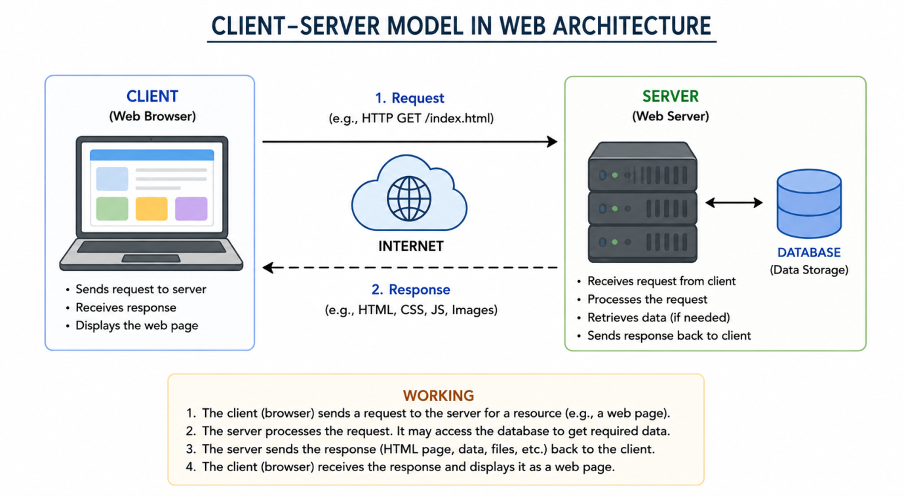
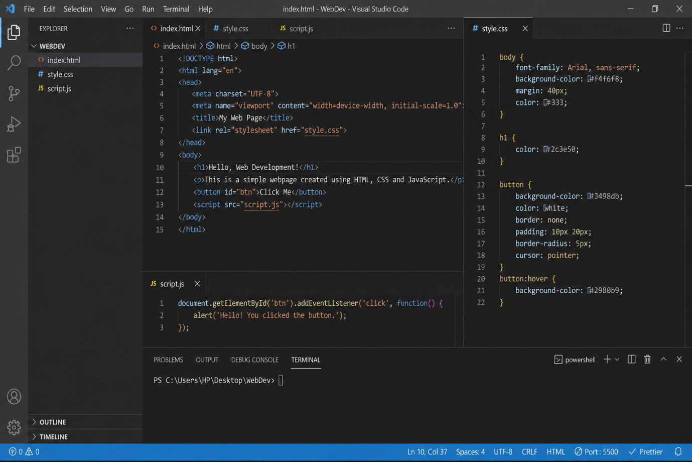
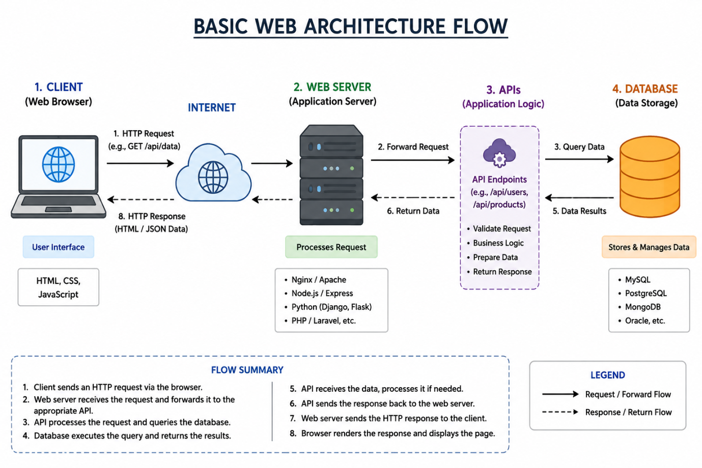

# ASSIGNMENT 1: Introduction to Web Development

**Student Name:** Aman Mudgal  
**Course / Lab:** BridgeLabz Training  
**Instructor:** Akash Gupta  
**Submission Category:** Submission of Intro to Web Dev  
**Date:** August 2026  

---

## 📑 Table of Contents
1. [Frontend, Backend & Full-Stack Development](#1-difference-between-frontend-backend-and-full-stack-development)
2. [Client-Server Model Architecture Diagram](#2-client-server-model-architecture)
3. [Browser Request & Page Display Lifecycle](#3-how-a-browser-requests-and-displays-a-web-page)
4. [Web Development Environment Setup & Tools](#4-tools-required-for-a-web-development-environment)
5. [What is a Web Server?](#5-what-is-a-web-server-and-examples)
6. [Team Roles in a Software Project](#6-roles-of-frontend-backend-and-dba-in-a-project)
7. [VS Code Configuration & Screenshot](#7-vs-code-installation--configuration)
8. [Static vs. Dynamic Websites](#8-static-vs-dynamic-websites)
9. [Web Browsers & Rendering Engines](#9-five-web-browsers--rendering-engines)
10. [End-to-End Web Architecture Flow Diagram](#10-labeled-web-architecture-flow-diagram)

---

## 1. Difference between Frontend, Backend, and Full-Stack Development

| Aspect | Frontend Development | Backend Development | Full-Stack Development |
| :--- | :--- | :--- | :--- |
| **Definition** | The "Client-Side" part of a website that users interact with directly in their web browser. | The "Server-Side" engine that handles application logic, database operations, and authentication. | The complete discipline covering both Client-Side and Server-Side software engineering. |
| **Core Technologies** | HTML5, CSS3, JavaScript (ES6+), React, Vue, Tailwind CSS | Node.js, Express, Java (Spring Boot), Python (Django/FastAPI), SQL/NoSQL | HTML, CSS, JavaScript, Node.js/Python, React, PostgreSQL/MongoDB |
| **Primary Goal** | Intuitive user experience (UX), visual responsiveness, and interactive presentation. | High availability, transactional integrity, business logic execution, data persistence, and security. | End-to-end feature delivery from database schema design to responsive UI rendering. |
| **Real-World Example** | **Amazon Product Page:** Buttons, product photos carousel, price layout, and interactive shopping cart animations. | **Amazon Payment Gateway:** Deducting account balance, verifying credit card via bank API, updating inventory in database. | **Complete E-Commerce Web App:** Architecting the entire shopping application from database schema to UI checkout flow. |

---

## 2. Client-Server Model Architecture

The client-server architecture is a foundational distributed computing structure where the **Client** (e.g., Chrome, Safari) requests services or content, and the **Server** (e.g., Nginx, Apache, Node.js) processes the request and sends back a response over the network via HTTP/HTTPS.



### Key Components:
- **Client:** The user's device running a web browser making an HTTP Request.
- **Network / Internet:** The communication pipeline transmitting TCP/IP packets.
- **Server:** High-performance hardware running web server software listening for incoming requests on ports (80 for HTTP, 443 for HTTPS).
- **HTTP Response:** The data packet sent back containing status code (e.g., `200 OK`) and payloads (HTML, JSON, Images).

---

## 3. How a Browser Requests and Displays a Web Page

When a user types a URL (such as `https://www.example.com`) and presses Enter, the browser executes a 5-step lifecycle:

```
[User enters URL] 
       ↓
1. DNS Resolution (Translates Domain Name to IP Address)
       ↓
2. TCP Handshake & TLS Negotiation (Establishes secure HTTPS connection)
       ↓
3. HTTP Request Transmission (Browser sends GET /index.html)
       ↓
4. Server Processing & Response (Web Server executes logic & sends 200 OK + HTML)
       ↓
5. Browser Critical Rendering Path (Parses DOM + CSSOM → Render Tree → Layout → Paint)
```

1. **DNS Resolution:** The browser queries DNS caches and resolvers to translate human-friendly domain names (`example.com`) into numerical IP addresses (`93.184.216.34`).
2. **TCP 3-Way Handshake & SSL/TLS:** A reliable transport connection is established (SYN, SYN-ACK, ACK) and encrypted with TLS certificates for HTTPS security.
3. **HTTP Request:** The browser sends an HTTP request message specifying the method (`GET`), path, headers, and protocol version.
4. **Server Processing & Response:** The web server receives the request, loads or dynamically generates the resource, and responds with status codes (e.g., `200 OK`) and payloads.
5. **Critical Rendering Path (CRP):**
   - **DOM Tree:** Parses HTML into Document Object Model nodes.
   - **CSSOM Tree:** Parses CSS stylesheets into CSS Object Model.
   - **Render Tree:** Combines DOM and CSSOM to determine visible elements.
   - **Layout (Reflow):** Computes exact geometric coordinates and dimensions.
   - **Painting & Compositing:** Rasterizes pixels onto the screen surface.

---

## 4. Tools Required for a Web Development Environment

Setting up a robust web development workspace requires specialized tooling across each development stage:

| Tool Category | Recommended Tool | Purpose & Importance |
| :--- | :--- | :--- |
| **Code Editor** | Visual Studio Code (VS Code) | Lightweight yet powerful extensible source-code editor with IntelliSense, syntax highlighting, and debugging. |
| **Web Browser & DevTools** | Google Chrome / Mozilla Firefox | Rendering test bed and in-browser inspection suite (Console, Network analyzer, Elements inspector, Storage). |
| **JavaScript Runtime** | Node.js | Enables running JavaScript outside the browser for backend servers, automation scripts, and npm packages. |
| **Version Control System** | Git & GitHub | Tracks file revisions, facilitates safe branching, and backs up code repositories on remote cloud platforms. |
| **Live Development Server** | VS Code Live Server Extension | Automatically reloads browser tabs whenever HTML, CSS, or JS source files are edited and saved. |
| **API Client** | Postman / Thunder Client | Tests HTTP request endpoints (GET, POST, PUT, DELETE) before connecting them to frontend interfaces. |

---

## 5. What is a Web Server and Examples

### Definition:
A **Web Server** encompasses both hardware and software:
- **Hardware:** A physical computer connected to the internet that stores web server software and website assets (HTML, CSS, JS, media).
- **Software:** A program that understands URLs (web addresses) and HTTP/HTTPS protocols, listening on ports and serving web resources to requesting clients.

### Commonly Used Web Servers:
1. **Nginx:** High-performance, event-driven, asynchronous web server renowned for reverse proxying, load balancing, and high-traffic static asset delivery.
2. **Apache HTTP Server:** The battle-tested, modular open-source web server widely utilized globally with `.htaccess` configuration support.
3. **Microsoft IIS (Internet Information Services):** Enterprise web server deeply integrated with Windows Server environments and ASP.NET applications.
4. **Node.js with Express:** Lightweight, programmatic web server written in JavaScript, widely used for single-page applications and RESTful microservices.
5. **Caddy:** Modern web server written in Go that features automated HTTPS certificate generation (Let's Encrypt) out of the box.

---

## 6. Roles of Frontend, Backend, and DBA in a Project

In professional software development, specialized roles collaborate to build reliable enterprise solutions:

```
+-------------------------------------------------------+
|                 Software Project Team                 |
+-------------------------------------------------------+
         |                         |                    |
         v                         v                    v
+------------------+     +------------------+     +---------------+
| Frontend Dev     |     | Backend Dev      |     | Database Admin|
| - UI/UX Layouts  |<--->| - APIs & Logic   |<--->| - Schemas     |
| - Responsiveness |     | - Authentication |     | - Security    |
| - Accessibility  |     | - Data Pipelines |     | - Performance |
+------------------+     +------------------+     +---------------+
```

1. **Frontend Developer:**
   - Translates UI/UX design mockups (Figma) into responsive, accessible code.
   - Manages client-side state, form input validations, and browser cross-compatibility.
   - Optimizes rendering performance, animations, and network payload consumption.

2. **Backend Developer:**
   - Architects server-side business logic, transactional pipelines, and RESTful/GraphQL APIs.
   - Implements authentication, authorization, token lifecycle (JWT/OAuth), and encryption.
   - Integrates third-party service providers (payment gateways, transactional email, SMS).

3. **Database Administrator (DBA):**
   - Designs normalized relational (SQL) or document (NoSQL) database schemas.
   - Establishes disaster recovery protocols, point-in-time backups, and high-availability replication.
   - Tunes slow query performance via indexes and enforces granular database security policies.

---

## 7. VS Code Installation & Configuration

### Setup Steps:
1. Download and install Visual Studio Code from `https://code.visualstudio.com`.
2. Configure recommended extensions for modern web development:
   - **Live Server** (by Ritwick Dey) — Live reloading for static pages.
   - **Prettier - Code Formatter** — Automated code indentation and formatting.
   - **HTML CSS Support** — Intelligent CSS class and id completion.
   - **JavaScript (ES6) code snippets** — Accelerated JS development.
3. Configure `settings.json` with `"editor.formatOnSave": true` and appropriate tab spacing (2 or 4 spaces).

### Verified Workspace Setup:


---

## 8. Static vs. Dynamic Websites

| Feature | Static Website | Dynamic Website |
| :--- | :--- | :--- |
| **Content Nature** | Fixed, pre-built content identical for all visitors until manually edited. | Generated in real time based on user credentials, query parameters, or database records. |
| **Technology Stack** | Pure HTML, CSS, client-side JavaScript. | Server-side runtimes (Node.js, Python, Java, PHP) + Database engine (PostgreSQL, MongoDB). |
| **Loading Speed** | Ultra-fast; delivered straight from SSDs or Content Delivery Networks (CDNs). | Dependent on database query execution time and server computational load. |
| **Complexity** | Simple to build, host, and maintain with minimal security surface area. | Higher architectural complexity requiring database backups, server monitoring, and security patching. |
| **Real-World Example** | **Company Portfolio / Resume Website:** Displays identical biography and projects to every visitor. | **Social Media (Facebook / Twitter) & Netflix:** Feeds, profiles, and video catalogs personalized for each authenticated user. |

---

## 9. Five Web Browsers & Rendering Engines

A **Rendering Engine** is the core software component of a browser that parses HTML, applies CSS styling rules, and paints pixels onto the screen.

| Web Browser | Rendering Engine | JavaScript Engine | Characteristics & Innovations |
| :--- | :--- | :--- | :--- |
| **Google Chrome** | **Blink** (Chromium) | V8 | Industry standard; rapid multi-process architecture with superior developer tools. |
| **Microsoft Edge** | **Blink** (Chromium) | V8 | Windows-optimized Chromium build with enhanced memory management and sleeping tabs. |
| **Mozilla Firefox** | **Gecko** (Quantum) | SpiderMonkey | Open-source engine written partly in Rust; outstanding tracking protection and CSS Grid developer tools. |
| **Apple Safari** | **WebKit** | JavaScriptCore (Nitro) | Highly energy-efficient engine designed natively for macOS and iOS hardware acceleration. |
| **Opera** | **Blink** (Chromium) | V8 | Chromium-powered browser with built-in productivity sidebars and integrated workspaces. |

---

## 10. Labeled Web Architecture Flow Diagram

The complete request-response flow connecting the client interface, API layer, server logic, and database storage:



### End-to-End Workflow:
1. **User Client:** The client browser initiates an HTTP/HTTPS API call (e.g., `POST /api/orders`).
2. **API Gateway / Web Server:** The incoming request is authenticated and routed to the appropriate application server.
3. **Application Server Logic:** Backend controllers validate the payload, verify permissions, and apply business algorithms.
4. **Database Engine:** Data is queried or committed using SQL/NoSQL transactional queries.
5. **Response Delivery:** The backend formats the data into JSON, and the client browser updates the visual DOM dynamically without full-page reloads.

---

### 📦 Deliverables in this Folder:
- **`Introduction_to_Web_Development.docx`**: Original Word Document submission.
- **`README.md`**: Complete Markdown report with high-resolution diagrams.
- **`images/`**:
  - `client_server_model.png` (Question 2 Diagram)
  - `vscode_setup.png` (Question 7 Screenshot)
  - `web_architecture_flow.png` (Question 10 Diagram)
- **`index.html`**: Interactive web dashboard.
